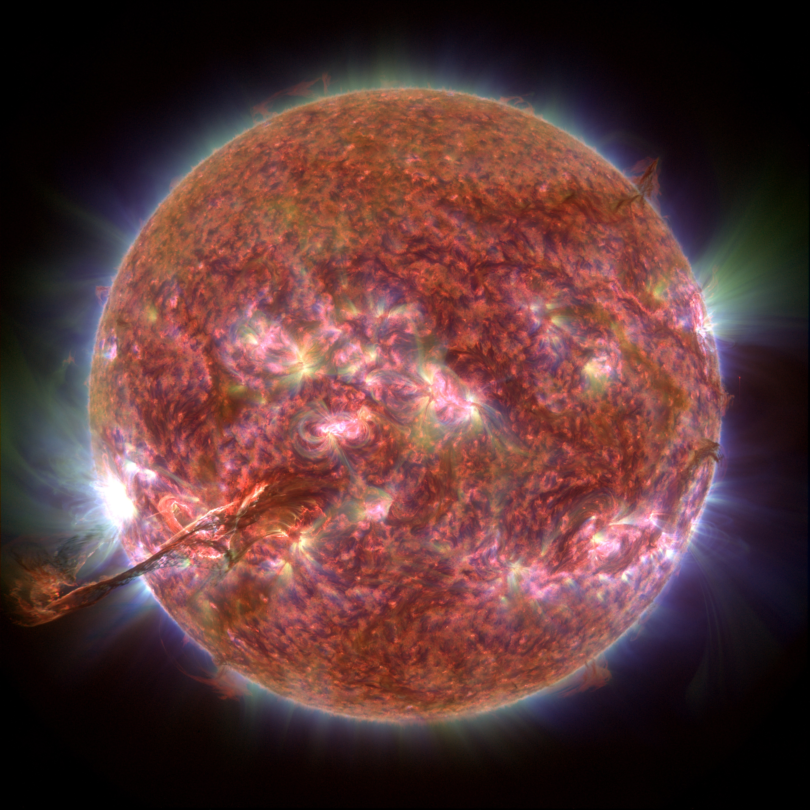

# AIA-reloaded
We are a group of solar physicists working with the Solar Dynamics Observatory (SDO), a NASA mission. This project is a singular attempt at delivering a new view of our nearest star through the combination of advanced image processing methods with more awareness on how we, as humans and scientists, associate color with information on the Sun. 

This repository provides python scripts and functions to create calibrated and enhanced RGB image series and movies from the full resolution images of SDO/AIA at 3 different wavebands. 

[](https://youtu.be/TG8th-Skhx0)
See youtube video at https://youtu.be/TG8th-Skhx0


## Installation

Download and unpack files into an empty parent directory.

Main python dependencies:

* Python 3 (tested on 3.5 and above)
* numpy 
* astropy
* opencv (version 3.x.x or 4.x.x)
* hvpy and tqdm (for downloading pre-calibrated JPEG2000 `.jp2` files via `get_data.py`)
* [optional] dash and `sunpy[visualization]` (for running the interactive perceptual LCh / RGB mixer app `interactive_rgb_mixer.py`; sunpy provides the SDO/AIA channel colormaps)
* [optional] pytest if you wish to run the unit tests. 

External dependencies:
* To fully automate the video creation from the rgb image series, you will need to install **ffmpeg**(https://www.ffmpeg.org)
 
If you wish to run the test functions with **pytest**: 

* Sample `.fits` and `.jp2` files for the 3 wavebands (171, 193, 304) are located in the **samples** directory (original raw FITS test files are also available at [AIA 171](https://drive.google.com/open?id=1-qT9RFb8NXFWlhbvNVVXm52JJ0cjLJyV), [AIA 193](https://drive.google.com/open?id=1NCVU91LQoFfmZMdg9eFec6nzdDf6q7Qx), and [AIA 304](https://drive.google.com/open?id=1lCoKH_BghuCuFwsrTVbtBz76ynVG_NQP)).
* From the terminal, go into the project directory and run **pytest test/test_aia.py -v**

### How does it work? 

#### Preferred workflow: Pre-calibrated JPEG2000 (`.jp2`) files vs. raw FITS files

While this framework supports raw SDO/AIA `.fits` files (which require downloading large uncompressed files and running the computationally expensive `aiaprep` calibration step to remap plate scales and rotations), **the preferred alternative is to use pre-calibrated JPEG2000 (`.jp2`) files** from Helioviewer:

* **Much smaller & faster to download**: `.jp2` files are a fraction of the size of raw FITS files and can be downloaded directly over any UTC time range using the included `get_data.py` script (powered by `hvpy`).
* **Pre-calibrated & faster to process**: Helioviewer `.jp2` images are already aligned, prepped, and intensity-scaled, bypassing `aiaprep` calibration and non-linear gamma rescaling while applying dedicated default color mixing parameters (`set_jp2_default()`).

An example of single-frame RGB image processing is given in **example_RGBMixer.py**. Our examples use the wavebands centered at 304 (red channel), 171 (green channel) and 193 Angstrom (blue channel). Default rescaling and color mixing parameters are provided for both `.jp2` and `.fits` inputs, and can be customized.
A full pipeline script for `.jp2` series (including movie creation) is provided in **script_full_pipeline.py**, and standalone movies can be encoded directly from a folder of RGB images using **create_movie.py** (see examples below).
The assignment of these wavebands to these colors is chosen in accordance to general human perception of colors. To that end, we are studying how to best make use of the CIE-based color spaces (e.g: CIELab, CIELuv, ...) instead of directly acting on the mixing between the RGB components which is not always the most intuitive or natural way to obtain the results we want. 

### Getting started

#### 1. Downloading and processing `.jp2` files (Recommended)

You can download a time series of pre-calibrated `.jp2` files using `get_data.py`:

```bash
python get_data.py "2012-08-31 18:00" "2012-08-31 22:00" --cadence 36 --wavelengths 304 171 193 --base-dir ~/data/AIA
```

This creates an event folder (`~/data/AIA/event_2012-08-31_1800_2012-08-31_2200/`) with `304/`, `171/`, and `193/` subdirectories. You can then run the full pipeline script to generate all RGB/CIELab `.jpeg` frames in parallel and encode the `.mp4` movie:

```bash
python script_full_pipeline.py ~/data/AIA/event_2012-08-31_1800_2012-08-31_2200 -w 304 171 193 -n 4
```

Or in Python using `RGBMixer` with `jp2=True` (for example, using the included `.jp2` files in `samples/`):

```python
import os, glob
from visualization import RGBMixer

aia_mixer = RGBMixer(
    data_files=[glob.glob('samples/*.%s*.jp2' % wavel) for wavel in ['304', '171', '193']],
    jp2=True,
    outputdir=os.path.abspath('samples/'))
aia_mixer.set_jp2_default()

aia_mixer.process_rgb(0)
```

#### 2. Processing raw `.fits` files

If you are working with raw FITS files instead, omit `jp2=True` and call `set_aia_default()`. Here is an example using the 3 sample FITS files in `samples/` that writes a `.jpeg` image with default FITS calibration, scaling, and color mixing parameters:

```python
import os, glob
from visualization import RGBMixer

## Create rgb image using the default aia rgb mixer for raw FITS files.
aia_mixer = RGBMixer(
    data_files=[glob.glob('samples/*.%s*.fits' % wavel) for wavel in ['304', '171', '193']],
    outputdir=os.path.abspath('samples/'))
aia_mixer.set_aia_default()

aia_mixer.process_rgb(0)
```

The above example will produce one colored image at full resolution in .jpeg that is visually identical to a lossless format (e.g png). 
typically, beamers in conferences are at best at "full HD", i.e 1920x1080. That means you do not use the whole resolution. What you display with a powerpoint or keynote presentation is actually downsampled to fit the screen. So our pipeline uses FFMPEG to enable you to do this downsampling and get properly sized video, with much managable file sizes to share with various media (powerpoint, youtube, ...). 

We also provide options to create videos and crop within the full resolution images for close-ups. Nonetheless, even a full resolution jpeg image size is 4.1 MB. if you do not want or do not need to retain the full resolution images and prefer to directly crop them before creating the image series, you can ask for cropped image directly when instantiating the RGBMixer class. For example, to only retain the bottom half of the sun one would add the following optional crop parameter:

```python
aia_mixer.crop = (slice(0, 4096), slice(2048, 4096)) # (x, y) = (cols, rows) slices
```

To create movies in Python, you'll process multiple RGB images from a directory of `.jp2` (or `.fits`) files. Instead of ```aia_mixer.process_rgb(0)``` you would use ```aia_mixer.process_rgb_list(ncores, file_range)``` where e.g: ```file_range = range(200)``` to process images, and ```ncores = 4``` to parallelize over 4 workers. 

Here is an example of the full pipeline in Python for processing a series of `.jp2` images (or `.fits` images if `jp2=False`) and creating a movie of the full sun with a square resolution of 1080x1080:

```python
import os
import visualization

# Set parallelization. To disable, set ncores to 1. Try to leave 1 or 2 cores available in your machine if you want to keep working normally:
# E.g., if you have 8 cores in your computer (whether virtual cores or physical cores). Use maximum ncores = 6
ncores = 4

data_dir = os.path.expanduser('~/data/AIA/event_2012-08-31_1800_2012-08-31_2200')
outputdir = os.path.join(data_dir, 'rgb_images')
os.makedirs(outputdir, exist_ok=True)

aia_mixer = visualization.RGBMixer(
    data_dir=data_dir,
    wavel_dirs=['304', '171', '193'],
    jp2=True,  # Set to False if using raw .fits files
    outputdir=outputdir)
aia_mixer.set_jp2_default()  # Or aia_mixer.set_aia_default() for .fits files

# Process all available frames (or pass a specific range, e.g. range(225))
n_frames = min(len(files) for files in aia_mixer.data_files)
aia_mixer.process_rgb_list(ncores, range(n_frames))
```

This will be followed by the encoding of the movie with FFMPEG. Once the RGB `.jpeg` images are available in a folder, you can encode movies either **directly from the terminal using `create_movie.py`** (without writing any Python setup code) or **in Python using `visualization.encode_video()`**.

#### Option A: Creating movies from the command line with `create_movie.py`

`create_movie.py` wraps `visualization.encode_video()` in a command-line interface and automatically generates a descriptive `.mp4` filename in the parent event directory (unless `-o/--output` is specified):

```bash
# Full sun rescaled to 1080x1080 px (or -s 2048 2048 for 1/2 resolution on 4K/5K screens)
python create_movie.py ~/data/AIA/event_2012-08-31_1800_2012-08-31_2200/rgb_images -s 1080 1080

# Full sun rescaled to 1080x1080 and padded to 16:9 (1920x1080) for optimized YouTube streaming
python create_movie.py ~/data/AIA/event_2012-08-31_1800_2012-08-31_2200/rgb_images -s 1080 1080 -p 1920 1080

# 16:9 close-up crop [width height x y] around the bottom half, output at Full HD (1920x1080) or 4K (-s 3840 2160)
python create_movie.py ~/data/AIA/event_2012-08-31_1800_2012-08-31_2200/rgb_images -c 3840 2160 128 1936 -s 1920 1080

# Square 2048x2048 crop in the bottom-left quadrant at full resolution (or -s 1024 1024 for half resolution)
python create_movie.py ~/data/AIA/event_2012-08-31_1800_2012-08-31_2200/rgb_images -c 2048 2048 0 2048 -s 2048 2048
```

Additional options for `create_movie.py`:
* `-c` / `--crop WIDTH HEIGHT X Y`: Crop window where `(X, Y)` is the top-left corner.
* `-s` / `--frame-size WIDTH HEIGHT`: Output video resolution in pixels.
* `-p` / `--padded-size WIDTH HEIGHT`: Optional padded frame size in pixels.
* `--fps FPS`: Frames per second (default: `30`).
* `--pattern PATTERN`: Glob pattern for input images (default: `"*.jpeg"`).
* `-o` / `--output PATH`: Custom output movie path/filename (without `.mp4`).

#### Option B: Creating movies in Python with `visualization.encode_video()`

```python
##### Create .mp4 videos

## full sun rescaled to 1080x1080 px (or use (2048, 2048) for 1/2 resolution on 4K/5K screens)
frame_size = (1080, 1080)
filename = 'rgb_movie_full_sun_1080x1080'
fps = 30  # Number of frames per second
visualization.encode_video(aia_mixer.outputdir, filename, fps=fps, frame_size=frame_size)
```
Video at: https://youtu.be/LivB3rEmXJQ (make sure you set the maximum resolution on the player)


Sometimes some media players work better if you provide videos with a 16:9 or 4:3 geometry. For the video above, we can instead get a padded version, where black stripes will be added on either side of our initial 1080x1080 picture frame to make it a 1920x1080 video. We would just add the extra ```padded_size``` parameter of (1920,1080):

```python
## Rectangularly padded to fit 16:9 1920x1080p for optimized youtube streaming
padded_size = (1920, 1080)
visualization.encode_video(aia_mixer.outputdir, filename, fps=fps, frame_size=frame_size, padded_size=padded_size)
```
Video at: https://youtu.be/XyqYKlLQZ8o (make sure you set the maximum resolution on the player)

Having such 16:9 ratio usually enables your computer to decode and play the video more efficiently than a less "standard" geometry. 4:3 is also a standard geometry that plays nicely in modest computers and older softwares. Youtube players work best at 16:9. The file size is the same, as the padding only add zeros. 
The file size of the above videos is ~5.5 MB. 

Another example is if you want a close-up on the sun, so you can view a sub-field of the sun at higher resolution. The `crop` argument takes `[width, height, x, y]`, where `x, y` are the top-left corner coordinates of the cropping window.

Here, we crop a 3840x2160 section (which is a 16:9 geometry) around the bottom half of the 4096x4096 frame, and encode this at Full HD (1920x1080) or full 4K UHD resolution (3840x2160):

```python
image_pattern_search = f"{aia_mixer.filename_lab}_*.jpeg"
crop = [3840, 2160, 128, 1936]  # [width, height, x, y]
frame_size = (1920, 1080)       # or (3840, 2160) for full 4K resolution
movie_filename = 'rgb_movie_3840x2160_1920x1080'
fps = 30
# Encode movie
visualization.encode_video(aia_mixer.outputdir, movie_filename, fps=fps, crop=crop, frame_size=frame_size, image_pattern_search=image_pattern_search)
```
Video at: https://youtu.be/CqIhzQMOLRw

As we have more information in this 1920x1080 than above, the file size is a bit bigger, ~15 MB. Considering we had 225 images of ~4.1 MB, that would have resulted in nearly 1 GB of uncompressed video size for the full sun, for virtually no difference in how the images are rendedered on a typical full HD display!

Similarly, you can crop a square region (e.g. a 2048x2048 window in the bottom-left quadrant) and output it at full resolution or half resolution:

```python
# Cropping over a 2048 x 2048 window in the bottom-left quadrant, at full resolution (or (1024, 1024) for half resolution)
crop = [2048, 2048, 0, 2048]  # [width, height, x, y] where x, y are top-left corner of the cropping window
frame_size = (2048, 2048)
movie_filename = 'rgb_movie_crop_2048x2048_2048x2048'
fps = 30
visualization.encode_video(aia_mixer.outputdir, movie_filename, fps=fps, crop=crop, frame_size=frame_size)
```

---

### Interactive Perceptual LCh & RGB Mixer (`interactive_rgb_mixer.py`)

Directly tuning the 9 raw coefficients of the $3 \times 3$ `self.rgbmix` matrix can be unintuitive. `interactive_rgb_mixer.py` provides a local **Plotly Dash** web application that decomposes the 3 columns of `self.rgbmix` into a linear perceptual **Oklch** opponent color space (**Hue** angle $H^\circ$, **Chroma / Saturation** $C$, and **Luminance / Lightness** $L$) and maps any adjustment back into a drop-in $3 \times 3$ `self.rgbmix` matrix for `visualization.py`.

#### Launching the app

```bash
python interactive_rgb_mixer.py
```

Then open **http://127.0.0.1:8050** in your browser. It starts on the sample `.jp2` files in `samples/` (`--samples-dir` to change) and also lists every `event_*` folder found in `~/data/AIA` (`--data-dir` to change), i.e. the folders written by `get_data.py`. Use `--port` to change the port.

#### Key features

* **Data Source (top-left pane):** choose *Samples* or an event folder (`<data-dir>/event_*/<wavelength>/*.jp2`). For an event, frames are the timestamps present in every channel folder; browse them with the frame slider (a typed frame number applies when the box loses focus) or the ◀ / ▶ buttons. Each new frame decodes its full-resolution JP2s on demand (~1 s); the last 3 frames stay cached. Selecting an event sets the R/G/B inputs to 304 / 171 / 131 Å when present; a missing preferred channel is replaced by the next available one, and with fewer than three channels the remaining slot is left empty (an all-zero input, selectable as "— empty —" in each R/G/B dropdown). The Option 1/2 and tone settings are kept when changing frame or event. **Save Full-Res JPEG** writes the current frame to `samples/` or `<event>/mixer_exports/`, named after the channels, tone settings and frame time.
* **Auto-Balance Rules & Presets (top-left pane):**
  * **Warm–Cool Harmony:** split-complementary thermal ordering placing the red input at vermilion-orange ($24^\circ$) and the green input at amber-gold ($106^\circ$), opposed by the blue input at complementary cerulean-blue ($245^\circ$), with chromas solved against the on-disk channel means for a slightly warm disk-mean color.
  * **White-Patch (Max-RGB):** Von Kries per-output-channel gains on the default palette so the brightest structures (flares, active-region cores) render neutral white instead of tinted.
  * Both rules are computed from the on-disk pixels of the selected wavelengths after the Tone Curve, and scaled so the brightest 0.5% of on-disk pixels just reach full scale.
  * **Save Preset…:** asks for a filename (default `preset_<date>_<time>.json`) and writes the Option 1 (global) and Option 2 (per-waveband) slider settings to `presets/<name>.json` in the project folder. Existing files are never overwritten. The file also records the wavelengths and resulting `rgbmix` for reference.
  * **Load Preset…:** opens the browser's file picker (navigate to `presets/` the first time; browsers do not let a page choose the starting folder) and restores both slider sets. Wavelengths, tone curve and channel visibility are left as they are.
* **Option 1 — Global Perceptual LCh (3 Sliders + Color Wheel):**
  * **Global Hue Shift ($\Delta H^\circ$)**, **Global Chroma ($\times C$)**, and **Global Luminance ($\times L$)** sliders that rotate and scale the color balance across the entire Sun at constant perceptual lightness, paired with a live polar **Oklch Color Wheel** showing the positions of `304`, `171`, and `193`.
  * The Global Hue colorbar is computed from the rendered Sun itself: the color under the cursor is the dominant (lightness-weighted) hue the Sun takes at that shift, so placing the cursor on red gives a red Sun. The resulting Sun hue is shown next to the slider value.
* **Option 2 — Per-Waveband LCh Controls (`304 Å`, `171 Å`, `193 Å`):**
  * Individual **Hue**, **Chroma**, and **Luminance** sliders for each waveband (corresponding to the 3 columns of `self.rgbmix`). Option 1 and Option 2 sliders stay bidirectionally synchronized, and every slider rides directly on a live gradient colorbar with a color-matched thumb.
* **Real-Time Comparison & Export:**
  * **Sharpening & Structure panel** (left, below Option 2; collapsible): applied to each input channel after the Tone Curve and before mixing, so the mix gets no color fringes. Also available in the pipeline as `RGBMixer.structure`, `RGBMixer.sharpen` and `visualization.scale_rgb(..., structure=, sharpen=)`, so the saved image (and the copied snippet) reproduce the preview.
    * **Structure (MGN):** Multi-scale Gaussian Normalization (Morgan & Druckmüller 2014): at Gaussian scales of 1.25–40 full-resolution pixels, `arctan(0.7 · (x − local mean) / local std)` is averaged and added to the image with the slider's weight. Reveals coronal loops, fans and off-limb structure; flat (zero) areas stay black.
    * **Sharpening (unsharp mask, Lightroom-style):** *Amount* (0 = off), *Radius* in full-resolution pixels, *Detail* (halo allowance: low values clamp the overshoot to the local min/max, removing halos at the limb and around flare kernels) and *Masking* (sharpen only where the edge strength exceeds that percentile, leaving the smooth off-limb sky unsharpened; the threshold is computed once on the full-resolution channels so every view and the saved file mask the same structures).
    * Radii and MGN scales are defined in full-resolution pixels and scaled for each preview, so the 1:1 zoom views match the full-resolution output; fine sharpening is barely visible in the downsampled full-sun previews. A full-resolution save with Structure on takes a few extra seconds per channel.
  * **Channel visibility (eye) toggles:** an eye button on each input-channel thumbnail hides that channel from the mix (its `self.rgbmix` column is zeroed for display only) to see what each wavelength contributes. No slider, anchor or preset is changed to compensate, the exported matrix stays the full mix, and showing the channel again restores the exact image. A full-resolution save matches the preview and is tagged, e.g. `..._hide171_gamma1.00_contrast0.0_0000.jpeg`.
  * **Tone Curve panel** (directly below the mixed image): applied to each input channel before mixing, exactly as `visualization.scale_rgb` does, so the full-resolution save and the copied snippet reproduce the preview.
    * **Gamma γ:** maps $x \in [0, 1]$ to $x^{1/\gamma}$ (`RGBMixer.gamma_rgb`). $\gamma > 1$ lifts faint loops and off-limb corona strongly (e.g. at $\gamma = 2$: $0.1 \to 0.32$) while already-bright structures barely change ($0.9 \to 0.95$), but it also flattens mid-tone contrast.
    * **Contrast:** a normalized sigmoidal S-curve (`visualization.sigmoid_contrast`, `RGBMixer.contrast` / `RGBMixer.contrast_mid`) applied after gamma. Each channel gets its own pivot (`visualization.mean_preserving_midpoint`), chosen so that channel's mean level is unchanged; because the mix is linear, contrast then changes neither the overall brightness nor the color balance, whatever the Option 1/2 sliders (a single shared pivot used to brighten mixes dominated by 304/193 Å much more than others). It steepens the mid-tones to restore the contrast lost to gamma while keeping black at 0 and white at 1, so nothing clips. 0 turns it off (the pipeline default).
    * Auto-Balance presets, the Global Hue colorbar and the balance metrics are computed on the tone-mapped inputs.
  * **Wavelength selector:** every `*.<wavelength>.jp2` file in the samples folder is loaded (e.g. `sample.131.jp2`, `sample.211.jp2`, downloadable with `get_data.py`). A dropdown above each input-channel image assigns any wavelength to the R, G or B input (one column of `self.rgbmix`); the mix, statistics, Auto-Balance presets and all labels update immediately. Saved images are named after the assignment and the Tone Curve settings, e.g. `im_custom_lch_jp2_304_171_211_gamma2.00_contrast6.0_0000.jpeg`.
  * Switch between Full Sun previews (`1024×1024` / `1536×1536`), a 16:9 bottom-half crop, or 1:1 native pixel zooms on the erupting prominence and active region loops. The live mix is displayed side-by-side with the three selected input channels (default `304 Å` → R, `171 Å` → G, `193 Å` → B), each rendered in its standard sunpy SDO/AIA colormap (`sdoaia304`, `sdoaia171`, …), or the input channels can be shown alone in a row.
  * Copy the live-generated `self.rgbmix = np.array([...])` code snippet directly into `visualization.py`, or click **Save Full 4096×4096 JPEG to `samples/`** to render the full-resolution image via `RGBMixer`.

